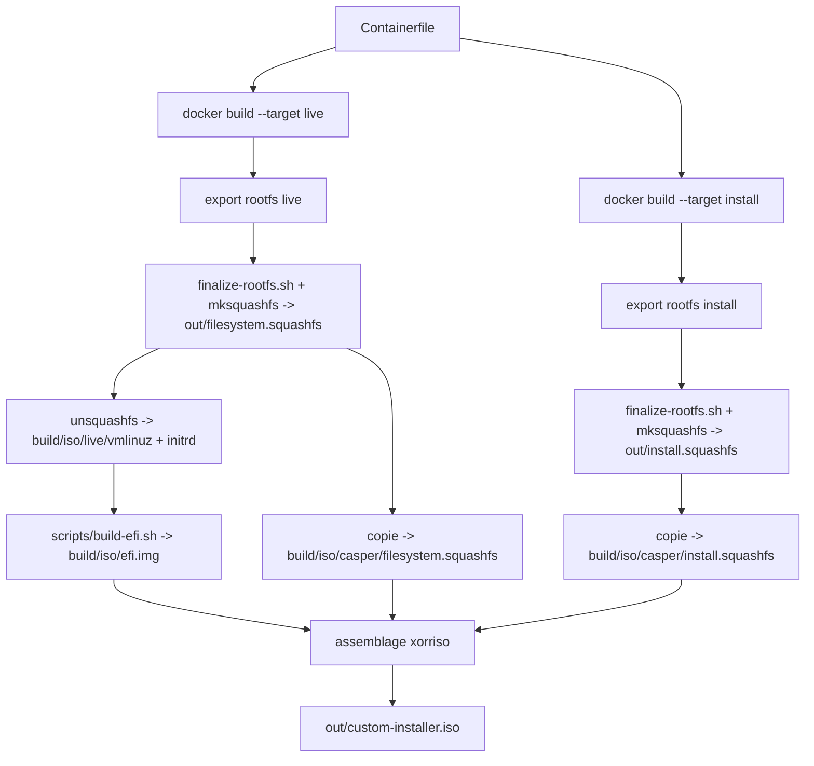
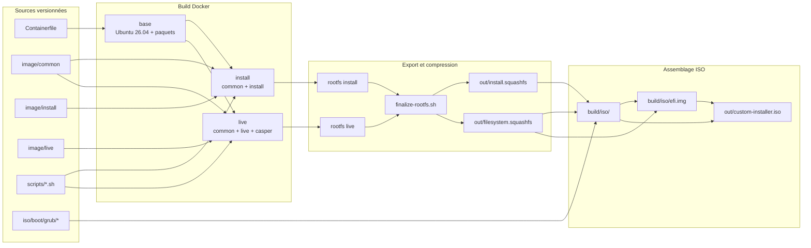
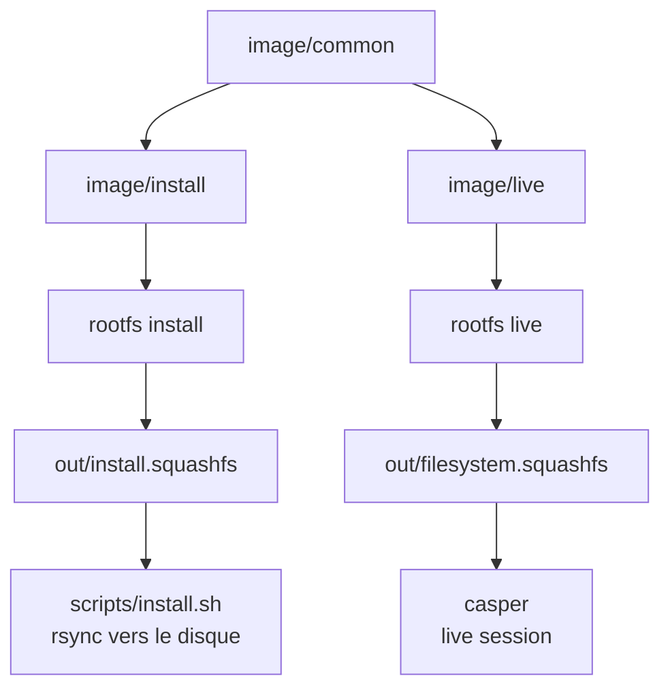

# docker2iso — Ubuntu 26.04 live et installable (UEFI Secure Boot + BIOS)

> Forge d'ISO Ubuntu hybride : système live et système installable, signés Secure Boot (UEFI + BIOS), construits depuis Docker en une seule commande `make iso`.

Ce projet construit une ISO hybride à partir de deux images Docker Ubuntu 26.04 :

- `out/filesystem.squashfs` : système **live** (GNOME + casper + installateur automatique) ;
- `out/install.squashfs` : système **installé** (GNOME propre, sans casper ni installateur).

L'ISO démarre en **UEFI avec Secure Boot** grâce à `shim-signed` et GRUB signé par Canonical, et reste compatible **BIOS/CSM**. Aucune inscription MOK n'est nécessaire : la chaîne utilise les clés Microsoft déjà présentes dans le firmware.

## Objectif

- Construire deux images Docker Ubuntu 26.04 :
  - `live` : desktop + `casper` + installateur (pour le LiveISO) ;
  - `install` : desktop propre, sans installateur (système copié sur le disque).
- Décrire le contenu des images dans une arborescence overlay unique, `image/`, copiée dans Docker avec `COPY` (modèle proche de bootc).
- Exporter ces images en rootfs et les compresser en `out/filesystem.squashfs` et `out/install.squashfs`.
- Installer `out/install.squashfs` sur un disque GPT (EFI + racine ext4) avec `scripts/install.sh`.
- Avoir GRUB fonctionnel en UEFI Secure Boot **et** en BIOS.
- Avoir un clavier **AZERTY FR** dans le live et dans le système installé.
- Éviter les polices de secours dans GNOME Terminal avec `fonts-ubuntu`.
- Corriger l'identité machine et les droits de `monuser` / GDM pour que la session GNOME démarre normalement.

## Arborescence du repo

```text
.
├── Containerfile                 # Dockerfile multi-étapes (live + install)
├── Makefile                      # SquashFS -> ISO hybride
├── README.md
├── image/                        # contenu copié dans les rootfs
│   ├── README.md                 # règles de l'overlay
│   ├── common/                   # commun aux images live et install
│   │   └── etc/
│   │       ├── default/
│   │       │   ├── grub
│   │       │   ├── keyboard
│   │       │   └── locale
│   │       └── locale.conf
│   ├── install/                  # install.squashfs uniquement
│   └── live/                     # filesystem.squashfs uniquement
│       ├── etc/xdg/autostart/
│       │   └── liveinstall.desktop
│       └── usr/local/bin/
│           └── liveinstall-terminal
├── iso/                          # template de l'ISO (source versionnée)
│   └── boot/grub/
│       ├── grub.cfg
│       └── efi.cfg
├── scripts/
│   ├── build-squashfs.sh         # build Docker + export + mksquashfs
│   ├── finalize-rootfs.sh        # nettoyage post-export (identité machine)
│   ├── build-efi.sh              # image FAT16 EFI signée
│   └── install.sh                # installateur disque
├── build/                        # généré et ignoré : rootfs, ISO assemblée, EFI
└── out/                          # généré et ignoré : squashfs + ISO
```

Les fichiers de `image/` conservent leur chemin absolu : `image/common/etc/default/keyboard` devient `/etc/default/keyboard` dans le rootfs. L'ordre d'application est toujours :

1. `image/common/` ;
2. `image/install/` ou `image/live/`.

Un fichier de l'overlay cible remplace donc le même chemin fourni par `common/` ou par un paquet Debian. C'est le même principe que `COPY files/ /` dans une image bootc.

### Fichiers principaux

| Fichier | Rôle |
| --- | --- |
| `Containerfile` | Dockerfile multi-étapes : cible `live` et cible `install` |
| `scripts/build-squashfs.sh` | Build des 2 images Docker, export, finalisation et compression en SquashFS |
| `scripts/finalize-rootfs.sh` | Supprime les artefacts du conteneur et prépare l'identité machine au premier boot |
| `scripts/install.sh` | Partitionnement GPT/EFI, copie du SquashFS, installation GRUB Secure Boot |
| `scripts/build-efi.sh` | Construction de l'image FAT16 `build/iso/efi.img` avec shim et GRUB signés |
| `image/common/etc/default/keyboard` | Configuration clavier française (`/etc/default/keyboard`) |
| `image/common/etc/default/grub` | Configuration GRUB commune |
| `image/common/etc/default/locale` | Locale française pour PAM (`/etc/default/locale`) |
| `image/common/etc/locale.conf` | Locale française pour systemd (`/etc/locale.conf`) |
| `image/live/usr/local/bin/liveinstall-terminal` | Wrapper lancé par l'autostart GNOME du live |
| `image/live/etc/xdg/autostart/liveinstall.desktop` | Entrée `/etc/xdg/autostart` qui lance l'installateur |
| `iso/boot/grub/grub.cfg` | Menu GRUB du LiveISO |
| `iso/boot/grub/efi.cfg` | Petit `grub.cfg` de recherche, copié dans l'image EFI et à la racine de l'ISO |
| `Makefile` | Build complet : Docker -> 2 SquashFS -> ISO hybride BIOS + UEFI |
| `iso/` | Template de l'ISO (GRUB, configuration EFI) |
| `out/filesystem.squashfs` | Rootfs du live (desktop + casper + installateur) |
| `out/install.squashfs` | Rootfs du système installé (desktop propre, sans installateur) |

Les éléments générés (`out/*.squashfs`, `out/*.iso`, `build/`, `build/iso/efi.img`, `build/iso/md5sum.txt`, `build/iso/boot/grub/i386-pc/`) ne sont pas versionnés.

## Architecture et flux

### 1) Construction des SquashFS



### 2) Assemblage de l'ISO hybride

`make iso` effectue les opérations suivantes :

1. recrée `build/iso/` depuis le template `iso/`, puis copie les deux SquashFS dans `build/iso/casper/` et l'installateur dans `build/iso/install/` ;
2. extrait `vmlinuz` et `initrd` **depuis le SquashFS live** vers `build/iso/live/` ;
3. appelle `scripts/build-efi.sh` pour créer une image FAT16 de 16 Mo, `build/iso/efi.img`, contenant :
   - `/EFI/BOOT/BOOTX64.EFI` : shim signé par Microsoft ;
   - `/EFI/BOOT/grubx64.efi` : GRUB signé par Canonical ;
   - `/EFI/BOOT/mmx64.efi` : utilitaire MOK de shim ;
   - `/EFI/ubuntu/grub.cfg` : configuration de recherche ;
4. copie aussi `iso/boot/grub/efi.cfg` dans `build/iso/EFI/ubuntu/grub.cfg` à la **racine de l'ISO** ;
5. lance une passe `grub-mkrescue` en mode BIOS pour générer `eltorito.img` **et les modules** `/boot/grub/i386-pc/`, puis les extrait dans `build/iso/boot/grub/i386-pc/` ;
6. génère `build/iso/md5sum.txt` (hors `efi.img` et modules GRUB générés) ;
7. assemble l'ISO finale avec `xorriso -as mkisofs` dans `out/custom-installer.iso`, avec :
   - une entrée El Torito BIOS ;
   - une entrée El Torito UEFI vers `/efi.img` ;
   - une table GPT/APM et un MBR hybride.

> **Pourquoi deux copies de `grub.cfg` ?** GRUB démarré depuis l'image EFI El Torito ne voit pas le contenu FAT de cette image comme un système de fichiers. Il voit l'ISO9660. On met donc le même fichier de recherche à la racine de l'ISO (`/EFI/ubuntu/grub.cfg`). La recherche se fait par fichier (`/boot/grub/grub.cfg`) et non par label de volume.

### 3) Chaîne de démarrage Secure Boot

```text
Firmware UEFI (clés Microsoft)
  -> EFI/BOOT/BOOTX64.EFI          (shim signé Microsoft)
  -> EFI/BOOT/grubx64.efi          (GRUB signé Canonical)
  -> /boot/grub/grub.cfg           (menu live ou menu installé)
  -> noyau + initrd
```

- Le shim est signé par Microsoft ; GRUB est signé par Canonical. Le firmware en mode Secure Boot les accepte sans MOK.
- Il ne faut **pas** copier `fbx64.efi` dans l'image EFI du live (`build/iso/efi.img`). Sur un support amovible, shim détecte `EFI/BOOT` et lance le fallback `fbx64.efi` ; sans `BOOTX64.CSV`, ce fallback redémarre la machine en boucle. C'est ce qui provoquait la boucle de démarrage UEFI. Sur le système installé, `grub-install` peut créer `fbx64.efi` et `BOOTX64.CSV` dans l'ESP ; c'est inoffensif tant que le CSV est présent.
- Sur le système installé, `grub-install --uefi-secure-boot` installe la chaîne signée dans `EFI/ubuntu`. Le script copie aussi shim et GRUB signés dans `EFI/BOOT` pour les firmwares qui démarrent directement le chemin amovible.

## Prérequis

Hôte Linux avec :

- Docker ;
- `grub-mkrescue` (`grub-pc-bin`, `grub-efi-amd64-bin`) ;
- `xorriso`, `mtools`, `dosfstools`, `squashfs-tools`, `fakeroot` ;
- `qemu-system-x86_64` pour les tests (facultatif).

Les binaires signés (`shim-signed`, `grub-efi-amd64-signed`) sont récupérés depuis le SquashFS live construit par le `Containerfile`.

## Utilisation

### Construire l'ISO

```bash
make iso
```

Après une modification du `Containerfile` ou de `image/`, repartir de zéro :

```bash
make distclean
make iso
```

Autres cibles :

```bash
make clean      # supprime build/ et l'ISO
make distclean  # supprime aussi les deux squashfs
make run        # boote l'ISO dans QEMU (KVM)
```

### Installer depuis l'ISO

1. Démarrer `out/custom-installer.iso` en UEFI (Secure Boot activé) ou en BIOS.
2. La session GNOME du live se connecte automatiquement et **ouvre un terminal qui lance l'installateur**.
3. Il demande de taper la confirmation exacte, par exemple :

   ```text
   DETRUIRE /dev/vda
   ```

   Le clavier du live est en **AZERTY français**. En cas de doute, vérifier le disque avec `lsblk`.

4. L'installateur partitionne le disque, copie `install.squashfs`, écrit `/etc/fstab`, configure l'identité machine, puis installe GRUB signé.
5. À la fin, retirer l'ISO et démarrer sur le disque.

Si nécessaire, relancer l'installateur à la main :

```bash
sudo /cdrom/install/install.sh
# ou
sudo /usr/local/bin/liveinstall
```

Si le disque n'est pas détecté automatiquement :

```bash
sudo env TARGET_DISK=/dev/vda /cdrom/install/install.sh
# ou
sudo env TARGET_DISK=/dev/nvme0n1 /cdrom/install/install.sh
```

L'installateur cherche `install.squashfs` dans `/cdrom/casper/`, `/casper/`, puis via `SQUASHFS_PATH=/chemin/vers/install.squashfs`. Il retombe sur `filesystem.squashfs` si `install.squashfs` est absent.

### Premier boot

1. Éteindre la VM.
2. Retirer l'ISO.
3. Démarrer sur le disque, en UEFI (Secure Boot possible) ou en BIOS.

Compte utilisateur : `monuser`, mot de passe : `osadmin` (mot de passe de test, à changer).

## Vérifications utiles

Sur l'hôte, après `make iso` :

```bash
# Structure El Torito (BIOS + UEFI)
xorriso -indev out/custom-installer.iso -report_el_torito plain

# Table GPT / MBR
xorriso -indev out/custom-installer.iso -report_system_area plain

# Intégrité des fichiers listés
( cd build/iso && md5sum -c md5sum.txt )

# Contenu de l'image EFI
mdir -i build/iso/efi.img ::/EFI/BOOT
mdir -i build/iso/efi.img ::/EFI/ubuntu
```

Sur le système installé :

```bash
mokutil --sb-state                  # Secure Boot activé ?
efibootmgr -v                       # entrée EFI/ubuntu
findmnt /boot/efi                   # ESP montée
dpkg -l fonts-ubuntu                # police du terminal
fc-match "Ubuntu Sans Mono"
id monuser                          # groupes
systemctl status gdm                # sur Ubuntu 26.04, l'unité est gdm.service
journalctl -b -u gdm --no-pager -n 80
```

## Dépannage

| Symptôme | Cause probable | Solution |
| --- | --- | --- |
| Boucle de démarrage UEFI, retour au firmware | `fbx64.efi` présent dans `EFI/BOOT`, sans `BOOTX64.CSV` | Ne pas copier `fbx64.efi` ; garder shim + `grubx64.efi` dans `EFI/BOOT` |
| `grub>` ou « fichier introuvable » après Secure Boot | GRUB signé cherche `/EFI/ubuntu/grub.cfg`, absent de l'ISO9660 | Générer `iso/boot/grub/efi.cfg` dans l'image EFI **et** à la racine de l'ISO |
| `grub rescue>` avec `part_*.mod` / `normal.mod not found` en BIOS | Seul `eltorito.img` a été copié, pas les modules GRUB | Extraire tout `/boot/grub/i386-pc` depuis l'ISO BIOS générée par `grub-mkrescue` |
| GNOME revient à l'écran GDM après le mot de passe | Home de `monuser` ou `/var/lib/gdm3` avec de mauvais droits ; clavier QWERTY/AZERTY | Vérifier `id monuser`, `ls -ld /home/monuser /var/lib/gdm3`, `journalctl -b -u gdm` ; saisir le mot de passe avec le bon layout |
| Texte mal espacé dans GNOME Terminal | Police Ubuntu Sans Mono absente et substitution inattendue | Installer `fonts-ubuntu` (déjà dans le `Containerfile`) |
| `casper` ne trouve pas le SquashFS | Ligne de démarrage incorrecte | La ligne doit être `linux /live/vmlinuz boot=casper ---` |
| Échec `initrd-switch-root` | Initramfs généré trop tôt | Rebuild avec `update-initramfs` final après `casper` |
| L'ISO ne démarre pas en BIOS | Modules GRUB BIOS absents | Vérifier la présence de `build/iso/boot/grub/i386-pc/normal.mod` et des fichiers `part_*.mod` |
| Une configuration du dépôt n'est pas appliquée | Fichier absent de `image/` ou écrasé par un postinst | Placer le fichier dans `image/common/` ou `image/<cible>/` ; il est copié après les paquets |

## Notes

- Le mot de passe `osadmin` est volontairement simple pour du test. **À changer** avant toute utilisation réelle.
- `os-prober` est installé mais désactivé par défaut ; il peut être activé pour un dual-boot.
- Secure Boot est pris en charge par shim + GRUB signés, sans UKI ni inscription MOK.
- La cible `install` ne contient ni `casper` ni l'installateur automatique.
- Le contenu de `image/common` est identique dans les deux images ; utiliser `image/install` ou `image/live` pour les différences.
- Le projet n'est pas encore une image ostree/bootc : `install.squashfs` reste un rootfs classique copié par `rsync`. Une évolution ostree nécessiterait `/usr` immuable, `/etc` mutable, `/var` d'état, `/ostree` et `ostree admin deploy` (voir plus bas).

## Diagramme d'architecture





> Les deux diagrammes ci-dessus sont la vue cible de l'arborescence overlay. Pour une vraie topologie ostree/Silverblue, remplacer la copie `rsync` par un déploiement `ostree admin deploy` et séparer `/usr` (immuable), `/etc` (mutable) et `/var` (état).
