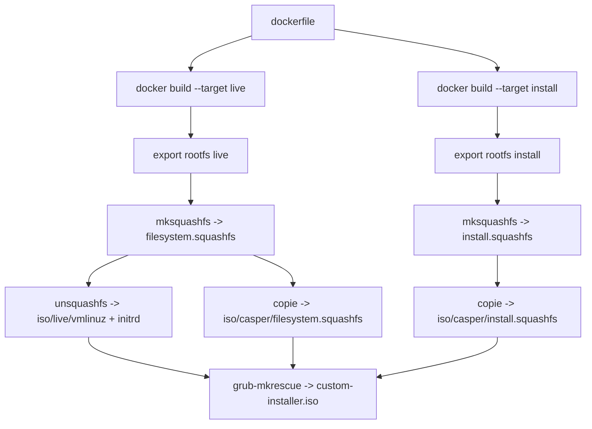
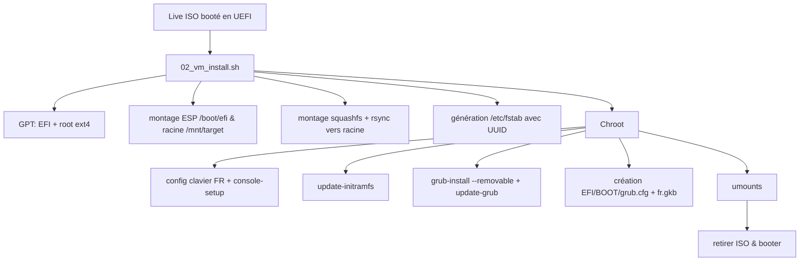
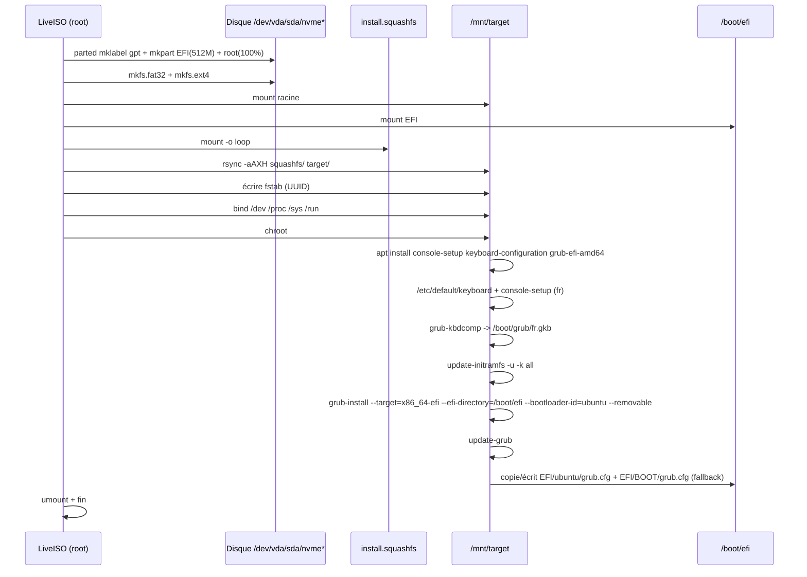

# LiveInstall - Build & Install d'un Ubuntu custom depuis un SquashFS (UEFI)

Ce petit projet sert à s'entraîner à fabriquer un système Ubuntu "sur-mesure" dans Docker, le compresser en `squashfs`, puis l'installer sur un disque UEFI depuis un LiveISO avec un script d'installation maison.

## Objectif

- Builder deux images Docker Ubuntu 26.04 :
  - `live` : desktop + `casper` + installateur (pour le LiveISO) ;
  - `install` : desktop propre, sans installateur (système copié sur le disque).
- Exporter ces images en rootfs et les compresser en `filesystem.squashfs` et `install.squashfs`
- Installer `install.squashfs` sur un disque VM (UEFI, sans Secure Boot) via `02_vm_install.sh`
- Avoir GRUB fonctionnel, clavier **AZERTY FR** dans le menu GRUB et dans le système

## Fichiers du repo

| Fichier | Rôle |
| --- | --- |
| `dockerfile` | Dockerfile multi-étapes : cible `live` et cible `install` |
| `01_build_squashfs.sh` | Build des 2 images Docker -> export tar -> 2 squashfs |
| `02_vm_install.sh` | Partitionnement GPT/EFI + copie squashfs + installation GRUB |
| `liveinstall-terminal.sh` | Wrapper lancé par l'autostart GNOME du live |
| `liveinstall-autostart.desktop` | Entrée `/etc/xdg/autostart` qui lance l'installateur |
| `Makefile` | Build complet : Docker -> 2 SquashFS -> `custom-installer.iso` |
| `iso/` | Arborescence du LiveISO (GRUB, noyau, initrd, installateur) |
| `filesystem.squashfs` | Rootfs du live (desktop + casper + installateur) |
| `install.squashfs` | Rootfs du système installé (desktop propre, sans installateur) |

## Architecture & flux

### 1) Construction des SquashFS



### 2) Installation sur disque UEFI



### 3) Séquence détaillée



## Utilisation

### Build de l'ISO (recommandé)

Prérequis : Docker, `grub-mkrescue` (`grub-pc-bin`, `grub-efi-amd64-bin`), `xorriso`, `mtools` et `squashfs-tools`.

```bash
make iso
```

Le Makefile enchaîne :

1. `./01_build_squashfs.sh` : build des cibles Docker `live` et `install`, export des rootfs, création de `filesystem.squashfs` et `install.squashfs` ;
2. copie des deux SquashFS dans `iso/casper/` (`filesystem.squashfs` et `install.squashfs`) ;
3. extraction de `vmlinuz` et `initrd` **depuis le SquashFS live** vers `iso/live/` ;
4. copie de `02_vm_install.sh` dans `iso/install/` ;
5. génération de `iso/md5sum.txt` pour `casper-md5check` ;
6. `grub-mkrescue` pour produire `custom-installer.iso`.

> L'extraction depuis le SquashFS évite de garder un noyau/initrd périmé dans `iso/live/`.
> Le `grub.cfg` est volontairement verbeux (`quiet splash` retiré) pour voir les erreurs de boot. Tu peux les remettre une fois que tout fonctionne.

Après une modification du `dockerfile`, repartir de zéro :

```bash
make distclean
make iso
```

Autres cibles :

```bash
make clean      # supprime l'ISO et les fichiers extraits
make distclean  # supprime aussi les deux squashfs
make run        # boote l'ISO dans QEMU (KVM)
```

### Installation depuis l'ISO

1. Démarrer `custom-installer.iso` en UEFI (ou en BIOS pour un test rapide).
2. La session GNOME du live se connecte automatiquement et **ouvre un terminal qui lance l'installateur tout seul**.
   Il demande de taper `DETRUIRE /dev/vda` (ou le disque choisi) pour confirmer.

Si besoin, l'installateur peut être relancé à la main :

```bash
sudo /cdrom/install/02_vm_install.sh
# ou, dans le live :
sudo /usr/local/bin/liveinstall
```

> Si l'ISO est montée ailleurs (clé USB), adapte le chemin, par exemple `/media/$USER/.../install/02_vm_install.sh`.

Si le disque n'est pas détecté automatiquement :

```bash
sudo env TARGET_DISK=/dev/vda /cdrom/install/02_vm_install.sh
# ou
sudo env TARGET_DISK=/dev/nvme0n1 /cdrom/install/02_vm_install.sh
```

> Le script retrouve `install.squashfs` dans `/cdrom/casper/`, `/casper/`, ou via `SQUASHFS_PATH=/chemin/vers/install.squashfs`.
> Il retombe sur `filesystem.squashfs` si `install.squashfs` est absent.

### Premier boot

1. Éteindre la VM
2. Retirer l'ISO
3. Démarrer sur le disque

Tu devrais arriver sur le menu GRUB et ton système devrait booter normalement.

## Pourquoi ces corrections ?

- **Deux images séparées** : la cible `live` embarque `casper` et l'installateur ; la cible `install` est le système propre copié sur le disque (sans `casper` ni autostart).
- **Installateur automatique** : une entrée `/etc/xdg/autostart` lance `gnome-terminal` au login du live, qui exécute l'installateur.
- **Détection dynamique du noyau** : plus besoin de hardcoder la version. Le script prend le plus récent présent dans `/boot/` après copie.
- **Initramfs régénéré en fin de build** : `update-initramfs -u -k all` après l'installation des paquets garantit la présence de `scripts/casper`, `overlay.ko` et `isofs.ko`. Un initramfs généré trop tôt ne peut pas monter le SquashFS.
- **Noyau/initrd extraits du SquashFS** : `make iso` évite les fichiers périmés dans `iso/live/`.
- **Keymap GRUB** : `grub-kbdcomp` génère `fr.gkb` et on le charge dans `EFI/BOOT/grub.cfg`. Beaucoup de firmwares UEFI tombent directement sur `\EFI\BOOT\BOOTX64.EFI` s'ils ne trouvent pas l'entrée "ubuntu" dans le boot menu.
- **`update-grub` dans le chroot** : génère un `grub.cfg` cohérent avec les modules, UUID, noyaux réels.
- **Détection disque** : fonctionne pour `vda/sda/nvme/xvda`.

## Dépannage rapide

| Symptôme | Vérification | Solution |
| --- | --- | --- |
| Échec `Failed to start initrd-switch-root.service` | Sur l'hôte, `lsinitramfs iso/live/initrd` doit lister `scripts/casper`, `overlay.ko` et `isofs.ko` | Rebuild avec l'étape `update-initramfs` finale du `dockerfile`, puis `make distclean && make iso`. |
| `casper` ne trouve pas le SquashFS / panic `iso-scan` | Vérifier `iso/boot/grub/grub.cfg` | La ligne doit être `linux /live/vmlinuz boot=casper ---` (sans `iso-scan/filename=...`). |
| Reste en QWERTY dans GRUB | Booter sur le disque, appuyer `c` dans GRUB (shell) et taper `keymap` ou regarder le layout | Le fallback `EFI/BOOT/grub.cfg` doit charger `fr.gkb`. Si absent, régénère avec le script corrigé. |
| GRUB apparaît mais rien ne démarre / erreur "you need to load kernel first" | Depuis GRUB shell: `ls (hd0,gpt2)/boot/` pour voir les vrais `vmlinuz-*` et `initrd.img-*` | Vérifie que les chemins existent bien. Le script prend le plus récent dynamiquement. |
| N'arrive pas sur GRUB, repart directement sur le live/UEFI | Vérifier l'ordre de boot UEFI (VirtualBox/virt-manager) | Forcer boot sur `ubuntu` ou `UEFI: <nom du disque>`. Le `--removable` copie aussi `BOOTX64.EFI` ce qui aide beaucoup. |
| Droits / montage | `lsblk -f` depuis le live | Vérifier que `P1`/`P2` correspondent bien au disque choisi. |

## Astuces pour aller plus loin

- **Personnaliser le Dockerfile** : tu peux rajouter `plasma-desktop`, `firefox`, etc. Plus c'est lourd, plus le squashfs grossit.
- **Utiliser `erofs`** : `mksquashfs` avec `-comp zstd` ou passer en `erofs` peut être plus rapide au boot.
- **Secure Boot** : ce setup est pensé "sans Secure Boot". Si tu actives SB, il te faudra `shim-signed` + `grub-efi-amd64-signed`.
- **Thème GRUB** : tu peux copier un thème dans `/boot/grub/themes/` et le pointer dans `/etc/default/grub` + `update-grub`.

## Notes

- Le mot de passe dans ton Dockerfile est volontairement simple pour du test (`osadmin`). **À changer** si tu comptes réutiliser ça ailleurs.
- `os-prober` est installé mais désactivé par défaut. Si tu as un dual-boot un jour, ça peut être utile.
- Le fallback `EFI/BOOT/grub.cfg` cherche la racine par UUID, donc il est assez résistant même si l'entrée `EFI/ubuntu` est "oubliée" par le firmware.
